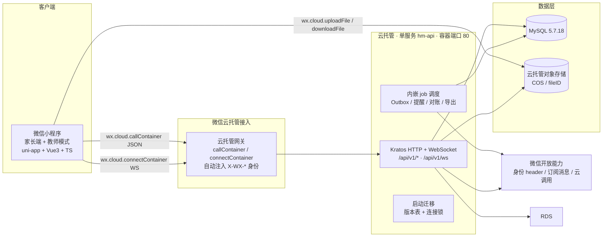

# 鹤鸣老师课堂 · 家校交付系统（HM-Lesson）

> 把「客户分层跟进 / 任务下发与作业批阅 / 一对一预约排课 / 课时台账 / 资料库 / 通知回执 / 家长门户 / 看板导出」做成一套**微信云托管**上的微信小程序 + Go 后端系统。

- **业务蓝本**：[`docs/鹤鸣老师课堂-飞书家校系统搭建需求与实施清单.docx`](<docs/鹤鸣老师课堂-飞书家校系统搭建需求与实施清单.docx>)（委托方原飞书零代码方案 V1.0，2026-11-17）
- **技术路线**：**微信云托管（上海，单服务 `hm-api`）** ｜ Go Kratos v3 + **MySQL 5.7.18（本地容器 / 生产云托管）** + **生产 COS / 本地 MinIO** + 一期不用 Redis ｜ uni-app（Vue3 + TypeScript）微信小程序，**家长端与教师模式同一个小程序、按角色区分**
- **域名**：小程序通过 `wx.cloud.callContainer` / `connectContainer` 直连云托管，**不需要服务器域名、不需要域名 ICP 备案**；当前没有域名备案也不影响上线。将来做 H5/Web/对外 API 时才需要已备案的自定义域名。
- **当前状态**：**M1 骨架 + 多老师认证 + 云托管首次部署 + M2 CRM/Excel 导入 + M3 任务主链路（2026-11-24）**。backend 已接入 Kratos v3，完成手机号+密码登录、JWT、owner/assistant 成员管理、Argon2id、`data.Migrate` 启动版本化迁移、`/api/v1/dashboard/summary`、家长绑定申请，以及 M2 的学员档案（含标签/回访/分组编辑）/跟进/绑定审批/绑定码/guardian 登录/家长门户与学员详情/Excel 预览-提交-回滚接口，M3 的任务列表/新建/发布、逐份提交、批阅/打回、重交、统计、模板与家长任务/档案/站内通知接口；`go build/vet/test` 通过，云托管已连接 MySQL 5.7.18 实测迁移、健康检查与 owner 登录。前端首页/工作台读取真实汇总，教师学员/跟进/审批/导入/任务/批阅页与家长登录/门户/任务/档案页已落盘，支持家长作业/批阅弹窗、拍照提交与教师批改图；`vue-tsc` 与 `mp-weixin` 构建通过。**待** 云托管重新部署验证通知/图片与 M3 全链路。

---

## 1. 项目定位

定位为**工具类小程序**（作业收集与家校协作），服务独立学科老师（高中物理，班课与一对一并行）的私域交付场景；不是教育培训/招生平台，不做课程售卖、直播授课与即时通讯。系统只解决四件事：

1. **把家长按阶段分层管起来**（四类分组 + 标签 + 跟进留痕 + 回访提醒）；
2. **把任务与作业形成可统计的闭环**（下发 → 提交 → 批阅 / 打回 → 重交 → 逾期统计）；
3. **把一对一预约与课时算清楚**（时段 → 申请 → 审核 → 上课 → 消课，余额硬闸门）；
4. **把资料与通知按权限送达**（分组可见矩阵、回执确认、家长门户）。

一期范围以飞书需求文档第 1.4 节为准；范围外事项（即时通讯/聊天/客服会话、家长群聊、直播、商城、自动最优排课、短信兜底等）不在本期实现。

## 2. 总体架构



**通信协议（“全 protocol”）**：同一套 `.proto` 生成 gRPC 服务与 HTTP/JSON 路由；小程序（家长端 / 教师模式）经云托管网关走 HTTP/JSON + WebSocket，gRPC 仅用于内部服务与运维工具（不对公网暴露）。**不再有 Caddy/Nginx**：TLS 与路由由云托管网关负责。详见 [后端需求 §7](docs/backend-requirements.md#7-协议与-api-设计) 与 [云托管部署手册](docs/deploy-wechat-cloudrun.md)。

## 3. 技术栈

| 层 | 选型 | 版本基线 | 说明 |
| --- | --- | --- | --- |
| 部署 | **微信云托管**（上海，服务 `hm-api`） | — | 容器端口 80；MVP `min=max=1`；生产关闭公网访问 |
| 语言 | Go | **1.25+** | Kratos v3 的 `go.mod` 要求 `go 1.25.0` |
| 后端框架 | [go-kratos/kratos](https://github.com/go-kratos/kratos) | **v3.0.x**（`github.com/go-kratos/kratos/v3`） | v3 于 2026-06-26 发布，日志改用 `log/slog`，JWT 中间件迁至 contrib |
| IDL / 生成 | protobuf + [buf](https://buf.build) | buf 1.75（本机） | `buf lint` / `buf breaking`；`protoc-gen-go-http`、`protoc-gen-openapi` |
| 数据库 | **MySQL 5.7.18**：本地 Docker 容器 / 生产云托管 MySQL（Q22 已确认） | — | 主键 UUIDv7；`utf8mb4`、`datetime(3)`、`JSON`、生成列唯一索引 |
| 建表 | 内嵌 `migrations/*.sql` + `data.Migrate` | 启动时版本化迁移 | 成对 up/down；启动取连接级锁执行（ADR-003） |
| ORM / 驱动 | GORM v2 + `mysql` 驱动 | 最新稳定 | 复杂报表用原生 SQL；仓储接口隔离 |
| 缓存 / 锁 | **一期不用 Redis**（Q24）：MySQL 计数表 + 进程内 LRU | — | 扩多实例前必须补 Redis 或数据库共享状态 |
| 对象存储 | **生产云托管 COS；本地 MinIO 容器**（Q23） | — | 小程序 `wx.cloud.uploadFile` 得 `fileID`；私有读；服务端 COS SDK；本地 MinIO 仅 dev |
| 鉴权 | JWT（HS256，单服务） | — | 教师手机号 + 密码（Argon2id）；家长微信身份 + 手机号/绑定码 + 老师审批 |
| 前端 | uni-app（Vue3 + Vite + TypeScript） | 官方 `vite-ts` 模板 | 微信小程序：家长端 + 教师模式（同包、按角色分包） |
| 包管理 | pnpm workspace | pnpm ≥ 10（本机 12.15.0） | 禁止 npm / yarn 混用 |
| UI 组件 | [wot-design-uni](https://github.com/Moonofweisheng/wot-design-uni) | 1.14.x | Vue3 + TS 友好，70+ 组件，支持 easycom 与主题变量 |
| 状态 / 路由 | Pinia + uni 路由 | — | 页面以 `pages.json` 为准；教师页面独立分包 |
| 接入方式 | `wx.cloud.callContainer` / `connectContainer` | 基础库 ≥ 2.23.0 / 2.21.1 | 不需要服务器域名；请求 ≤100 KiB、响应 ≤1000 KiB、超时 ≤15 s |
| CI/CD | GitHub Actions → TCR → `wxcloud`；或控制台持续集成 | — | 镜像在 CI 构建；云托管只拉取运行 |
| 可观测 | slog JSON + 云托管日志/监控 + 健康检查 | — | 日志落 stdout；`/healthz` 不查库，`/readyz` 查库与存储 |

> 版本策略：以上为**基线**，实现时在 `go.mod` / `pnpm-lock.yaml` 中锁定精确版本；升级需单独提交并跑全量测试。

## 4. 仓库结构（目标形态）

```text
HM-Lesson/
├── README.md                     # 本文件：总览、快速开始、部署
├── AGENTS.md                     # 以后所有 AI/人类协作者的硬性操作规范
├── docs/
│   ├── 鹤鸣老师课堂-飞书家校系统搭建需求与实施清单.docx   # 原始业务蓝本（只读）
│   ├── backend-requirements.md   # 后端需求：模块、业务规则、接口、非功能、测试
│   ├── data-model.md             # 数据模型：ER、表结构、约束、迁移规范
│   ├── frontend-requirements.md  # 前端需求：家长端 + 教师模式页面、设计系统、验收
│   ├── deploy-wechat-cloudrun.md # 云托管部署手册（环境、DB、COS、CI、迁移、排查）
│   ├── decisions.md              # 架构决策记录（ADR）
│   └── open-questions.md         # 已定问题结论 + 新待定项
├── backend/
│   ├── api/proto/hm/v1/          # 单一事实来源：proto
│   ├── cmd/hm/                   # 单进程入口（api + 内嵌 job 调度）
│   ├── internal/{biz,data,service,server,conf}/
│   ├── migrations/                   # 启动时版本化迁移（embed，up/down）
│   ├── pkg/                      # 可复用工具：authz、storage、wx、notify、xlsx、jobrunner
│   ├── Dockerfile                # 云托管镜像
│   ├── Makefile
│   └── go.mod
├── frontend/
│   ├── pnpm-workspace.yaml
│   ├── apps/mp/                  # 小程序：家长端 + 教师模式（分包）
│   └── packages/{api-types,shared}/
├── deploy/
│   ├── cloudrun/                 # 云托管部署说明 / 环境变量样例
│   └── local/                    # 本地开发 compose（MySQL 5.7.18 + MinIO）
├── .github/workflows/            # CI + 云托管部署
└── scripts/
```

## 5. 角色与客户端

| 角色 | 入口 | 能做什么 | 硬边界 |
| --- | --- | --- | --- |
| 老师（负责人 `owner`） | 小程序 · 教师模式 | 全部数据；唯一审核人：预约审核、作业批阅、消课确认、课时调整、通知发送、成员管理 | 不可绕过审计改课时流水 |
| 家长 | 小程序 · 家长端 | 仅本人孩子：任务提交、作业档案、预约、资料、课时、回执 | 只能看到 `guardian_id` 绑定的学员；服务端强制隔离 |
| 学生 | 不单独建号 | 随家长账号 | 一期无独立账号 |
| 助教（`assistant`，二期启用） | 小程序 · 教师模式 | 批阅、下发任务、查看预约 | 不可见跟进记录、收费与课时成本、导出、成员管理 |

> Q1 已定：**不单独做教师 Web 端**，教师模式并入同一个小程序。教师页面放独立分包 `pkg-teacher`，仅 `role=staff/owner` 可进入；数据接口与家长端共用一套后端，权限由服务端判定。

## 6. 核心业务闭环

```text
咨询访客 ──跟进──> 待转化意向 ──试听/报名──> 班课在读 / 一对一在读
                                                │
       ┌────────────────────────────────────────┼─────────────────────────┐
       ▼                                        ▼                         ▼
  任务下发 → 提交 → 批阅/打回 → 重交        开放时段 → 预约 → 审核 → 上课 → 消课
       │                                                                  │
       └────────────── 作业档案 / 逾期名单 / 课时余额 / 续费预警 ◄────────┘

通知（回执）· 资料（分组可见）· 看板（四组指标）· 导出（四类名单）
```

规则细节见 [后端需求 §3](docs/backend-requirements.md#3-模块需求与业务规则)，与飞书原方案的差异见 [§11](#11-与飞书原方案的关键差异)。

## 7. 本地开发快速开始

### 7.1 环境要求

| 工具 | 版本 | 本机现状（2026-11-22 检测） |
| --- | --- | --- |
| Go | 1.25+ | ✅ 1.25.7 |
| Docker Desktop / Docker Engine + Compose | 24+ | ❌ 本机不安装；镜像构建与集成测试在 Debian/CI 跑 |
| Node.js | 22 LTS | ✅ v22.22.3 |
| pnpm | ≥ 10 | ✅ 12.15.0 |
| buf | 1.7x | ✅ 1.75.0 |
| 微信开发者工具 | 最新稳定版 | 未检测（需手动安装并登录） |
| 云托管 CLI（可选） | 以控制台为准 | 未安装；**安装前先询问** |

> ⚠️ **依赖与下载规则**：本仓库禁止代理自动安装/下载依赖。缺少 Go、Docker、微信开发者工具、云托管 CLI 或任何 npm/Go 模块时，**先告知委托方并由委托方本人安装**；网络慢时不要反复重试或换源硬扛，直接说明需要什么。

### 7.2 启动顺序（代码就位后）

```bash
# 1) 本地基础设施（可选；没有 Docker 时连远程 dev 数据库）
cd deploy/local
docker compose up -d mysql minio    # 开发默认值见 compose；生产用云托管 MySQL + COS

# 2) 后端（本地 :8000；云托管里监听 :80）
#    启动时自动 data.Migrate：在空库/新版本上执行 migrations/*.up.sql
cd ../../backend
make dev

# 3) 小程序（构建产物在 frontend/apps/mp/dist/build/mp-weixin，导入微信开发者工具）
cd ../frontend
pnpm install
pnpm --filter @hm/mp build:mp-weixin   # 开发预览用 dev:mp-weixin，产物在 dist/dev/mp-weixin
```

> 本地没有云托管网关，`wx.cloud.callContainer` 需要 `wx.cloud.init` 且环境可达；联调优先用云托管 `dev` 环境的公网访问（临时开启、用完关闭），或用 H5 条件编译走 `uni.request` 指向 `localhost:8000`。**两条路径必须共用 `utils/request.ts` 的同一套业务逻辑。**

### 7.3 常用命令（约定，随代码落地）

| 命令 | 作用 |
| --- | --- |
| `make api` | `buf generate` + OpenAPI → TS 类型 |
| `make lint` / `make test` / `make test-integration` | 后端质量门禁 |
| `pnpm lint` / `pnpm typecheck` / `pnpm test` / `pnpm build:mp` | 前端质量门禁 |
| `make seed` | 预留：写入标签、资料分类、默认设置（尚未实现；首个 owner 用 `HM_BOOTSTRAP_*`） |

## 8. 数据库与迁移

- **版本化迁移**（ADR-003/028）：唯一事实来源是 `backend/migrations/NNNN_*.up.sql` 与 `.down.sql`，成对提供，按版本只前进。
- **启动迁移**：`data.Migrate` 用同一 MySQL 连接取 `GET_LOCK('hm_migrate', 30)`，读 `schema_migrations` 当前版本，按顺序执行未应用的 up，失败则拒绝启动（fail fast）；`cmd/hm` 启动时自动调用，`cmd/migrate` 可手工 `up`/`down`/`version`。
- **方言已定 MySQL 5.7.18**（Q22）：`utf8mb4`、`datetime(3)`、`JSON`、生成列唯一索引；不写 PG 方言。
- **变更方式**：新增/修改表 → 新建 `migrations/NNNN_*.up.sql` 与 `.down.sql`；禁止修改已发布的迁移，修复用新迁移。
- **生产**：只前进；回滚优先“新迁移补偿”，破坏性 down 需备份与人工确认。

细节（表、索引、状态机、种子数据）见 [data-model.md](docs/data-model.md)。

## 9. 测试策略

| 层 | 工具 | 覆盖 |
| --- | --- | --- |
| 后端单元 | `go test` + testify | 状态机、课时计算、权限判定、参数校验 |
| 后端集成 | testcontainers-go 或 compose test profile | MySQL 5.7.18：迁移、事务、并发抢时段、消课幂等 |
| 接口契约 | `buf breaking` + HTTP 黑盒用例 | proto 兼容性、错误码、分页、鉴权 |
| 云托管契约 | httptest + 手动 | `X-WX-*` 头解析、100 KiB/1000 KiB 边界、15 s 超时、fileID、WS 首帧认证 |
| 前端单元 | Vitest + Vue Test Utils | 请求封装、store、金额/课时格式化 |
| 前端构建 | `vue-tsc` + `uni build -p mp-weixin` | 类型与产物完整性、主包/分包体积 |
| 端到端 | miniprogram-automator（可选）+ 手工清单 | 登录绑定、提交作业、预约、回执、文件上传 |
| 验收 | 飞书文档 TC-01 ~ TC-16 + TC-17 导入 | 全部映射，见 [后端需求 §10](docs/backend-requirements.md#10-验收用例映射) |

CI 门禁：`lint + typecheck + unit + integration + build` 全绿才允许合并。上线前必须跑完 17 条验收用例。**本机没有 Docker**：单元测试与构建在 Windows 上跑，集成测试（testcontainers）在 Debian 或 GitHub Actions 上跑；云托管联调在 `dev` 环境做。

## 10. 部署（微信云托管）

### 10.1 目标拓扑

```text
小程序 ──callContainer/connectContainer──> 微信云托管（上海）
                                             └─ hm-api（单服务，容器 :80，min=max=1）
                                                  ├─ MySQL 5.7.18（本地容器 / 生产云托管）
                                                  └─ COS（fileID）
```

- **不需要 Caddy/Nginx、不需要服务器域名、不需要域名 ICP 备案**；TLS 与路由由云托管负责。
- 生产**关闭公网访问**，只允许小程序/公众号调用；默认公网域名只用于联调。
- 单服务内同时跑 HTTP、WebSocket、内嵌 job 调度（Outbox、提醒、对账、导出）；MVP 不拆 worker。
- 镜像由 CI 构建推送 TCR，云托管拉取运行；容器启动执行“建表 + 起服务”。

### 10.2 上线步骤

1. 完成 **Q19/Q26**：确认工具类目提审路径与 AppID 是否变更；再创建生产云环境（环境绑定 AppID，事后变更成本高）。
2. 开通云托管，创建 `prod` 环境与服务 `hm-api`（端口 80，min=max=1，健康检查 `/healthz`）。
3. 数据库（Q22 已定）：云托管 MySQL 5.7.18；关闭自动暂停，配好连接串与备份。
4. 开通对象存储；配置 bucket、地域、私有读；服务端 COS 凭据入环境变量。
5. 配置环境变量（见部署手册 §7）；敏感值只放控制台。
6. 推镜像到 TCR，创建首个版本；观察启动日志与 `/readyz`。
7. 小程序 `wx.cloud.init`，接 `callContainer` / `connectContainer` / `uploadFile` 联调。
8. 关闭公网访问；配置告警、备份、预算。
9. 上传体验版 → 真机回归 17 条验收 → 提审发布。
10. 发布后 7 天观察 5xx、p95、job 失败、存储增长。

> 详细步骤、环境变量、CI Secrets、故障排查见 [docs/deploy-wechat-cloudrun.md](docs/deploy-wechat-cloudrun.md)。

### 10.3 微信侧硬性前置（Q2 已确认：当前为**个人主体、未认证**）

| 能力 | 个人未认证主体 | 本方案应对 |
| --- | --- | --- |
| 手机号快速验证 `getPhoneNumber` | ❌ 不可用（需认证主体） | 家长**手动输入手机号** + 老师审批 / 绑定码，不依赖该组件 |
| 订阅消息 | ⚠️ 可用但模板受类目限制 | 选“上课提醒/作业提醒”等通用模板；站内信保底 |
| 微信支付 | ❌ 不可用 | 一期不做支付，仅线下收费登记 |
| 类目 / 提审 | ⚠️ 按**工具（效率/教育工具）**类目提审，个人主体可先试 | 定位作业收集与家校协作工具，名称/简介/页面不出现培训、招生、售课；已砍即时通讯；若审核要求企业主体再变更（Q19） |
| 域名 ICP 备案 | ❌ 未办（**也不需要**） | 小程序调云托管不走域名；将来绑自定义域名才需 ICP |
| 小程序备案 | ✅ 已完成（个人主体） | 与域名 ICP 备案是两件事；已完成即可提交审核 |
| 云托管环境归属 | ⚠️ 环境绑定 AppID | 先确认 AppID 是否变更，再建生产环境；不变更则直接建（Q26） |

> 上述是硬约束，不是实现细节。**Q19 需要委托方确认工具类目与主体路径**（见 [open-questions.md](docs/open-questions.md)）。代码始终按“无手机号组件、无 IM”实现；后续若接入手机号快速验证只增一条分支，不改数据模型。

## 11. 与飞书原方案的关键差异

| 飞书原方案 | 本方案 | 原因 |
| --- | --- | --- |
| 多维表格当数据库 | MySQL 5.7.18 + Kratos 服务 + 版本化迁移 | 可测试、可审计、可扩展；支持并发与事务 |
| 飞书自动化 | Outbox 表 + 进程内 job 调度 + 订阅消息 / 站内信 | 云托管单服务内完成；投递可重试、可观测 |
| 知识库 + 分组权限 | 云托管对象存储（COS）+ 服务端权限矩阵 + fileID 鉴权 | 权限在服务端；小程序直传，不经过 100 KiB 请求体 |
| 业务小程序（飞书） | 自研 uni-app 微信小程序 | 家长无需安装飞书；微信内直接打开 |
| 表格“行权限” | 服务端 `guardian_id` 数据隔离 + 审计日志 | 每个查询强制带归属条件 |
| 仪表盘 | 小程序教师模式 + SQL 指标 + 短缓存 | 手机上看板用卡片/进度条，不引图表库 |
| 飞书 IM | **直接砍掉**：无聊天/会话/客服消息；线下微信沟通 + 跟进记录留痕 | 即时通讯涉及额外类目与资质；需求本身也要求“结论落到表里” |
| 飞书消息卡片 | 订阅消息 + 小程序消息中心 + WebSocket | 微信一次性订阅有额度限制，需组合触达 |
| 飞书云空间/域名 | 云托管 `callContainer` + `connectContainer`；无域名 | 不需要服务器域名与域名 ICP 备案；公网访问可关闭 |

## 12. 里程碑

| 阶段 | 交付 | 退出条件 |
| --- | --- | --- |
| **M0 文档** ✅ | README / 前后端需求 / 数据模型 / AGENTS / 部署手册 / 问题清单 | 18 项决策已确认（2026-11-18）；部署改云托管（2026-11-22） |
| M1 骨架 ✅ | 仓库骨架、proto、版本化迁移脚本、云托管 Dockerfile、CI、多老师登录/成员管理、家长绑定（手机号+审批/绑定码） | 后端：Kratos v3、登录/成员管理、真实汇总、绑定申请、单测通过；前端：教师登录/成员页、首页/工作台真实数据、`vue-tsc` 与 `mp-weixin` 构建通过；云托管已实测迁移/健康检查/owner 登录 |
| M2 CRM ✅ | 学员/家长/标签/跟进/分组/回访 + Excel 导入 | 学员列表/新增/详情、档案编辑（标签/回访/分组）、跟进记录、绑定审批、6 位绑定码、guardian 登录、家长门户/学员详情（课时+作业+流水）、Excel 模板/预览/提交/回滚接口与教师导入页；已云端实测 |
| M3 任务 🚧 | 任务、派发、提交、批阅、打回、统计、模板、档案 | 教师任务列表/新建/发布/关闭/统计/逐份批阅/打回/批改图/模板，家长任务列表/详情/文字+拍照提交/历史/档案/发布与批阅站内弹窗；TC-03 ~ TC-06 已部分生产实测，图片上传待真机验证 |
| M4 预约与课时 | 时段、预约、审核、冲突、消课、余额闸门 | TC-07 ~ TC-12 |
| M5 资料/通知 | 资料权限矩阵、通知回执、消息中心 | TC-13、TC-15 |
| M6 看板/导出 | 四组指标、四类导出（xlsx）、教师模式打磨 | TC-14、TC-16、TC-17 |
| M7 上线 | 压测、备份演练、隐私合规、体验版回归、提审 | 17 条全过 + 上线检查表 + **工具类目提审通过** + 公网访问关闭 |

## 13. 明确不做（一期）

即时通讯（家长-老师聊天、群聊、客服会话）、直播授课、商城交易、自动最优排课、短信兜底推送、学情自动分析、录播挂载、线上支付/退款。助教角色与成员表结构一期预留，但**不开放**助教登录（Q5：以后可扩，不现在做）。

## 14. 文档索引

| 文档 | 读者 | 内容 |
| --- | --- | --- |
| [AGENTS.md](AGENTS.md) | AI / 开发者 | 硬性规范、命令、禁区、DoD |
| [docs/backend-requirements.md](docs/backend-requirements.md) | 后端 | 模块规则、权限、接口、任务、非功能、测试 |
| [docs/data-model.md](docs/data-model.md) | 后端 | ER、表、索引、约束、迁移与种子 |
| [docs/frontend-requirements.md](docs/frontend-requirements.md) | 前端 | 家长端 + 教师模式页面、交互、设计系统、微信限制、验收 |
| [docs/deploy-wechat-cloudrun.md](docs/deploy-wechat-cloudrun.md) | 运维 / 后端 | 云托管开通、数据库、COS、环境变量、迁移、CI、域名、排查 |
| [docs/decisions.md](docs/decisions.md) | 后端 / 架构 | 27 条架构决策与回滚方式 |
| [docs/open-questions.md](docs/open-questions.md) | 委托方 | Q1–Q28 已确认；Q19 需控制台试开通、提审 |
| [docs/test-report.md](docs/test-report.md) | 测试 / 开发 | 自动化与 TC-01~17 手工验收记录（当前未开始） |

## 15. 约定

- 文档语言：中文；代码标识符、日志字段、错误 `reason`：英文 `snake_case`。
- 时间：数据库存 UTC（MySQL `datetime(3)`），展示统一 `Asia/Shanghai`。
- 金额/课时：`decimal(12,2)` / `decimal(6,2)`，**禁用 float**。
- 主键：UUIDv7，MySQL 用 `char(36)`。
- 提交信息：Conventional Commits（`feat|fix|docs|refactor|test|chore|perf`）。
- 分支：`main` 保护；功能分支 `feat/<scope>-<short>`；上线打 `v0.x.y` tag。
- 云托管：容器只监听 80，日志只写 stdout，文件只写对象存储；请求不超 100 KiB / 响应不超 1000 KiB / 超时 15 s。
- **已修复环境问题**：根目录 `.gitignore` 曾被 ACL 锁定且为 UTF-16；现已重写为 UTF-8，覆盖 `.env`、`node_modules/`、`frontend/**/dist/`、`backend/gen/`、`.graphflow/`、`.dsh-acl-recovery/` 等构建与本地文件。


