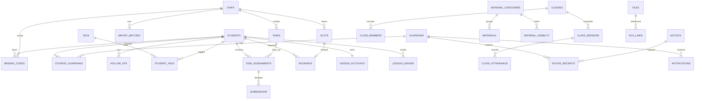
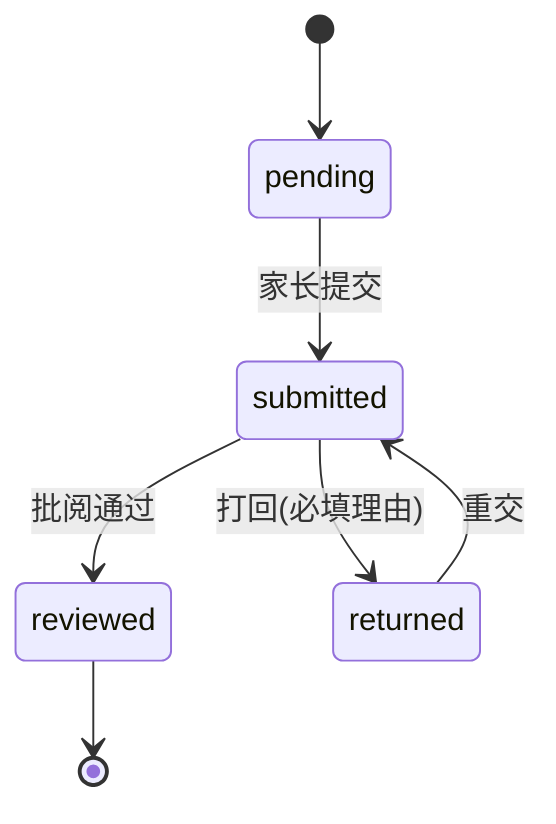
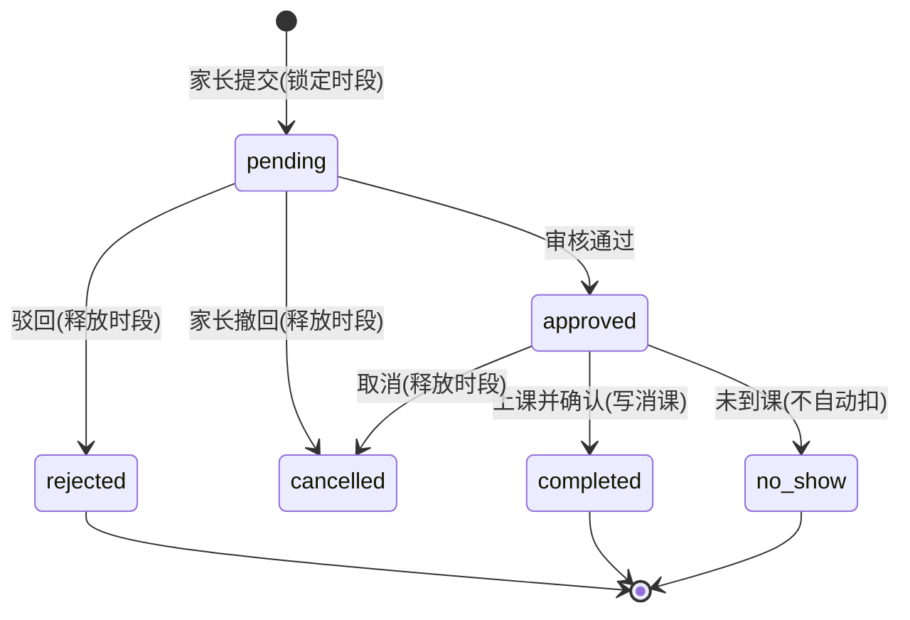

# 数据模型与迁移规范 · HM-Lesson

> 配套：[backend-requirements.md](backend-requirements.md) §3 业务规则
> 目标数据库：**MySQL 5.7.18**（本地 Docker 容器 / 生产云托管 MySQL，Q22 已确认）
> 迁移方式：按版本执行 `backend/migrations/*.sql`（成对 up/down），启动时 `data.Migrate` 加锁执行（ADR-003）
> 原则：**约束优先于代码**——能在数据库层表达的（唯一、外键、检查、唯一索引）就不要只写在 Service 里。

> ⚠️ **方言说明（2026-11-22 已确认 MySQL 5.7.18）**
> 目标库为 **MySQL 5.7.18**（本地容器 / 生产云托管）。本文档 §2–§12 的字段表沿用 PostgreSQL 类型描述**逻辑模型**（表、字段、语义、状态机不变）；**实际建表语句以 [`backend/migrations/000001_init.up.sql`](../backend/migrations/000001_init.up.sql)、[`000002_teaching.up.sql`](../backend/migrations/000002_teaching.up.sql) 为准**，已按 MySQL 方言编写，down 脚本随版本成对提供。两种方言的映射见 §1.1；新增脚本一律用 MySQL 语法，不要再照抄 PG 类型。

---

## 1. 建模约定

| 项 | 约定 | 理由 |
| --- | --- | --- |
| 主键 | `id`，应用生成 **UUIDv7**（时间有序）；PG `uuid`，MySQL `char(36)` | 不可枚举、可离线生成、索引局部性好 |
| 时间 | 存 UTC；PG `timestamptz`，MySQL `datetime(3)` | 跨时区无歧义；展示层转上海 |
| 枚举 | `text/varchar` + `CHECK (col IN (...))`，不用数据库原生 enum | 增加取值只需改约束，迁移简单 |
| 金额/课时 | `numeric(12,2)` / `numeric(6,2)`（MySQL `decimal`） | 精确计算，禁止 float |
| 手机号 | `varchar(32)`，统一存 `+86` E.164；唯一 | 绑定匹配、去重 |
| 布尔 | PG `boolean`；MySQL `tinyint(1)`，`NOT NULL DEFAULT 0` | 避免三态 |
| 软删除 | 业务表用 `status` 表达，不设 `deleted_at` | 蓝本要求不物理删除 |
| 乐观锁 | `version integer NOT NULL DEFAULT 1` | 批阅/审核/编辑并发 |
| 审计列 | `created_at`、`updated_at`、`created_by`、`updated_by` | 追溯 |
| 命名 | 表复数 `snake_case`，**全小写**（MySQL `lower_case_table_names` 建库后不可改）；索引 `idx_表_列`；唯一 `uq_`；外键 `fk_` | 可读、跨方言 |
| 字符集 | PG UTF8；MySQL `utf8mb4` + `utf8mb4_unicode_ci` | 支持 emoji、排序稳定 |
| 扩展 | PG `pgcrypto`、`btree_gist`；MySQL 无扩展，时段排他用应用事务 | 方言差异 |

> 所有 UUID 由后端生成，数据库不设默认值，避免应用与 DB 行为不一致。

### 1.1 方言映射（Q22 已定：MySQL 5.7.18）

| 逻辑 | PostgreSQL 17（不采用，仅对照） | MySQL 5.7.18（目标库） |
| --- | --- | --- |
| UUID 主键 | `uuid` | `char(36)`，`ascii_bin`/`utf8mb4_bin` 排序 |
| 时间 | `timestamptz` | `datetime(3)`，连接 `loc=UTC` |
| JSON | `jsonb` | `json`（不依赖 JSON 路径索引） |
| 金额/课时 | `numeric(12,2)` | `decimal(12,2)` |
| 布尔 | `boolean` | `tinyint(1)` |
| 枚举 | `text + CHECK` | `varchar(32) + CHECK`（5.7 解析但忽略，应用层必须校验） |
| 默认值 | `now()` | `CURRENT_TIMESTAMP(3)` |
| 自增/返回 | `RETURNING` | `LAST_INSERT_ID()` / 再查 |
| Upsert | `ON CONFLICT` | `ON DUPLICATE KEY UPDATE` |
| 部分唯一索引 | `CREATE UNIQUE INDEX ... WHERE status IN (...)` | **不支持**：生成列 `active_flag` + `UNIQUE(slot_id, active_flag)` |
| 字符串匹配 | `ILIKE` | `LIKE` + `utf8mb4_unicode_ci`（大小写不敏感） |
| 聚合过滤 | `FILTER (WHERE ...)` | `SUM(CASE WHEN ... THEN ... END)` |
| 锁 | `pg_advisory_lock` | `GET_LOCK('name', seconds)` |
| 行锁跳过 | `FOR UPDATE SKIP LOCKED` | `FOR UPDATE SKIP LOCKED`（8.0 支持） |

> **预约冲突（ADR-011/TC-08）MySQL 写法**：
> `active_flag tinyint GENERATED ALWAYS AS (CASE WHEN status IN ('pending','approved') THEN 1 ELSE NULL END) STORED`，再 `UNIQUE KEY uq_bookings_slot_active (slot_id, active_flag)`。NULL 不参与唯一性，因此同一时段只能有一条有效预约。

## 2. ER 总览



## 3. 表结构

> 下列为**逻辑结构**，最终 DDL 以 `backend/migrations/*.sql` 为准；字段顺序、默认值、约束名必须一致。

### 3.1 账号与身份

#### `staff` 老师/管理员

| 列 | 类型 | 约束/默认 | 说明 |
| --- | --- | --- | --- |
| id | uuid | PK | |
| name | varchar(64) | NOT NULL | |
| phone | varchar(32) | NOT NULL UNIQUE | 登录名 |
| password_hash | text | NOT NULL | Argon2id |
| role | text | NOT NULL DEFAULT 'owner', CHECK IN ('owner','assistant') | 一期只创建 owner；结构支持多老师（Q5） |
| status | text | NOT NULL DEFAULT 'active', CHECK IN ('active','disabled') | |
| last_login_at | timestamptz | NULL | |
| created_by | uuid | FK staff(id) NULL | 成员由 owner 创建 |
| created_at / updated_at | timestamptz | NOT NULL DEFAULT now() | |

#### `guardians` 家长

| 列 | 类型 | 约束/默认 | 说明 |
| --- | --- | --- | --- |
| id | uuid | PK | |
| name | varchar(64) | NOT NULL | |
| phone | varchar(32) | NOT NULL UNIQUE | 匹配与通知 |
| wx_openid | varchar(64) | UNIQUE NULL | 小程序 openid |
| wx_unionid | varchar(64) | NULL | 预留 |
| status | text | NOT NULL DEFAULT 'pending', CHECK IN ('pending','active','rejected','disabled') | 待审批/正常/拒绝/禁用 |
| approved_by | uuid | FK staff(id) NULL | |
| approved_at | timestamptz | NULL | |
| rejected_reason | text | NULL | 拒绝绑定时必填 |
| bound_at | timestamptz | NULL | 首次绑定微信 |
| remark | text | NULL | |
| created_at / updated_at | timestamptz | NOT NULL DEFAULT now() | |

索引：`uq_guardians_phone`、`uq_guardians_wx_openid`。

#### `students` 学员

| 列 | 类型 | 约束/默认 | 说明 |
| --- | --- | --- | --- |
| id | uuid | PK | |
| name | varchar(64) | NOT NULL | |
| grade | text | NOT NULL, CHECK IN ('g1','g2','g3','other') | 高一/高二/高三/其他 |
| school | varchar(128) | NULL | |
| group_code | text | NOT NULL, CHECK IN ('class','one_on_one','lead','visitor') | 四类固定分组 |
| status | text | NOT NULL DEFAULT 'active', CHECK IN ('active','paused','archived','churned') | |
| source | text | NOT NULL, CHECK IN ('douyin','xiaohongshu','referral','offline','other') | |
| next_follow_up_at | timestamptz | NULL | 回访提醒 |
| archived_reason | text | NULL | 归档原因 |
| remark | text | NULL | |
| version | int | NOT NULL DEFAULT 1 | |
| created_at / updated_at | timestamptz | NOT NULL DEFAULT now() | |

索引：`idx_students_group_status`、`idx_students_next_follow_up`（部分索引 `WHERE status IN ('active','paused')`）、`idx_students_name`。

> 蓝本把家长姓名/手机号放在学员表；这里拆出 `guardians`，同一家长多孩只维护一份联系方式。

#### `student_guardians` 学员-家长关系

| 列 | 类型 | 约束 | 说明 |
| --- | --- | --- | --- |
| student_id | uuid | FK students(id), PK | |
| guardian_id | uuid | FK guardians(id), PK | |
| relation | text | CHECK IN ('father','mother','grandparent','other') | |
| is_primary | boolean | NOT NULL DEFAULT false | 主联系人 |
| created_at | timestamptz | NOT NULL DEFAULT now() | |

索引：`uq_student_primary` UNIQUE (student_id) WHERE is_primary；`idx_sg_guardian`。
删除限制：学员存在任务/预约时禁止解除关系（或仅标记）。

#### `auth_refresh_tokens`

| 列 | 类型 | 约束 | 说明 |
| --- | --- | --- | --- |
| id | uuid | PK | |
| subject_type | text | CHECK IN ('staff','guardian') | |
| subject_id | uuid | NOT NULL | |
| token_hash | char(64) | NOT NULL UNIQUE | SHA-256 |
| expires_at | timestamptz | NOT NULL | |
| revoked_at | timestamptz | NULL | |
| user_agent | varchar(255) | NULL | |
| ip | inet | NULL | |
| created_at | timestamptz | NOT NULL DEFAULT now() | |

索引：`idx_art_subject`、`idx_art_expires`（清理任务）。

#### `binding_codes` 家长绑定码

| 列 | 类型 | 约束/默认 | 说明 |
| --- | --- | --- | --- |
| id | uuid | PK | |
| code | char(6) | NOT NULL UNIQUE | 6 位数字，生成时避免前导 0 歧义可存字符串 |
| student_id | uuid | NOT NULL, FK students(id) | 绑定的学员 |
| created_by | uuid | NOT NULL, FK staff(id) | 生成人（owner） |
| expires_at | timestamptz | NOT NULL | 默认 7 天 |
| used_at | timestamptz | NULL | 一次性，使用后置位 |
| used_by_guardian_id | uuid | FK guardians(id) NULL | 绑定成功的家长 |
| created_at | timestamptz | NOT NULL DEFAULT now() | |

索引：`uq_binding_codes_code`、`idx_binding_codes_student`（未使用且未过期）。清理：过期 30 天后由 job 删除。

#### `import_batches` Excel 导入批次

| 列 | 类型 | 约束/默认 | 说明 |
| --- | --- | --- | --- |
| id | uuid | PK | |
| kind | text | NOT NULL DEFAULT 'students', CHECK IN ('students') | 预留其他类型 |
| file_id | uuid | NULL | 原始 xlsx（当前直传解析，不落 files） |
| status | text | NOT NULL DEFAULT 'preview', CHECK IN ('preview','committed','failed','rolled_back') | |
| mode | varchar(16) | NOT NULL DEFAULT 'create' | `create` / `update`（update 预留） |
| total_rows / created_rows / skipped_rows | int | NOT NULL DEFAULT 0 | 统计 |
| error_count | int | NOT NULL DEFAULT 0 | |
| error_report | json | NULL | `[{row, field, message}]`；预览逐行错误 |
| rows_json | MEDIUMTEXT | NULL | 预览解析后的行，提交/回滚按批次使用 |
| created_by | uuid | NOT NULL, FK staff(id) | 仅 owner |
| created_at / committed_at / rolled_back_at | timestamptz | | |

索引：`idx_import_batches_created_by_time`。回滚只删除本批次 `created_rows` 中且无任务/预约/流水引用的学员与家长。
`students.import_batch_id`、`guardians.import_batch_id` 记录新建来源，便于回滚定位；迁移见 `backend/migrations/000003_import_batch.up.sql`。

### 3.2 标签与跟进

#### `tags`

| 列 | 类型 | 约束 | 说明 |
| --- | --- | --- | --- |
| id | uuid | PK | |
| category | text | NOT NULL, CHECK IN ('grade','paper','learning','operation') | 固定四类 |
| name | varchar(32) | NOT NULL | |
| sort | int | NOT NULL DEFAULT 0 | |
| created_at | timestamptz | NOT NULL DEFAULT now() | |

约束：`UNIQUE (category, name)`。

#### `student_tags`

`student_id uuid FK`、`tag_id uuid FK`、`created_at`；PK `(student_id, tag_id)`；索引 `idx_st_tags_tag`。

#### `follow_ups`

| 列 | 类型 | 约束 | 说明 |
| --- | --- | --- | --- |
| id | uuid | PK | |
| student_id | uuid | NOT NULL FK students(id) | |
| staff_id | uuid | NOT NULL FK staff(id) | |
| occurred_at | timestamptz | NOT NULL | |
| channel | text | NOT NULL, CHECK IN ('wechat','phone','meeting','other') | |
| content | text | NOT NULL | 沟通内容 |
| concern | text | NULL | 家长顾虑 |
| next_action | text | NULL | 下一步 |
| next_follow_up_at | timestamptz | NULL | |
| created_at | timestamptz | NOT NULL DEFAULT now() | |

索引：`idx_follow_ups_student_time (student_id, occurred_at DESC)`、`idx_follow_ups_next`。

### 3.3 任务与作业

#### `tasks`

> 实际建表以 `backend/migrations/000002_teaching.up.sql`、`000004_task_templates.up.sql` 为准。下表为逻辑模型；`audience_type/audience`、`closed_at`、`version` 等未建列，当前发布只接收显式 `student_ids`。

| 列 | 类型 | 约束 | 说明 |
| --- | --- | --- | --- |
| id | uuid | PK | |
| title | varchar(200) | NOT NULL | |
| description | text | NULL | |
| type | text | CHECK IN ('homework','correction','trial','checkin') | |
| status | text | NOT NULL DEFAULT 'draft', CHECK IN ('draft','published','closed') | |
| due_at | timestamptz | NOT NULL | |
| audience_type | text | CHECK IN ('students','group','tags') | |
| audience | jsonb | NOT NULL | 快照：`{student_ids:[]}` / `{group:"class"}` / `{tag_ids:[]}` |
| published_at | timestamptz | NULL | |
| closed_at | timestamptz | NULL | |
| created_by | uuid | NOT NULL FK staff(id) | |
| version | int | NOT NULL DEFAULT 1 | |
| created_at / updated_at | timestamptz | NOT NULL DEFAULT now() | |

索引：`idx_tasks_status_due (status, due_at)`。

#### `task_templates`

`id`、`title`、`description`、`type`、`due_offset_hours int`、`created_by`、`created_at/updated_at`（`000004_task_templates.up.sql`）。

#### `task_assignments`

> 当前实际表：`id/task_id/student_id/status/submitted_at/reviewed_at/score/comment/return_reason/review_file_ids/created_at/updated_at`（`review_file_ids` 由 `000005` 增加）；`guardian_id`、`reviewed_by`、`attempt_count`、`version` 未建列。

| 列 | 类型 | 约束 | 说明 |
| --- | --- | --- | --- |
| id | uuid | PK | |
| task_id | uuid | NOT NULL FK tasks(id) | |
| student_id | uuid | NOT NULL FK students(id) | |
| guardian_id | uuid | NOT NULL FK guardians(id) | 下发时快照 |
| status | text | NOT NULL DEFAULT 'pending', CHECK IN ('pending','submitted','reviewed','returned') | |
| due_at | timestamptz | NOT NULL | 快照，任务改期不影响已发 |
| submitted_at | timestamptz | NULL | 最近一次 |
| reviewed_at | timestamptz | NULL | |
| reviewed_by | uuid | NULL FK staff(id) | |
| score | numeric(5,2) | NULL, CHECK 0~100 | |
| comment | text | NULL | |
| return_reason | text | NULL | |
| review_file_ids | json | NULL | 教师批改图 fileID 数组，最多 9 张 |
| attempt_count | int | NOT NULL DEFAULT 0 | |
| version | int | NOT NULL DEFAULT 1 | |
| created_at / updated_at | timestamptz | NOT NULL DEFAULT now() | |

约束：`UNIQUE (task_id, student_id)`。
索引：`idx_assign_student_status (student_id, status)`、`idx_assign_status_due (status, due_at)`、`idx_assign_task`。

> 状态只有四个：打回后回 `pending`，重交再 `submitted`；提交历史在 `submissions`，不靠 assignment 状态表达。

#### `submissions`

| 列 | 类型 | 约束 | 说明 |
| --- | --- | --- | --- |
| id | uuid | PK | |
| assignment_id | uuid | NOT NULL FK task_assignments(id) | |
| version | int | NOT NULL | 从 1 递增（实际列名 `version`） |
| text_content | text | NULL | ≤5000 字 |
| is_late | boolean | NOT NULL DEFAULT false | |
| submitted_by | uuid | NOT NULL FK guardians(id) | |
| submitted_at | timestamptz | NOT NULL DEFAULT now() | |

约束：`UNIQUE (assignment_id, version)`；索引 `idx_submissions_submitted_at`。
附件：通过 `file_links`（`target_type='submission'`）。

#### `file_links` 通用附件关联

| 列 | 类型 | 约束 | 说明 |
| --- | --- | --- | --- |
| id | uuid | PK | |
| file_id | uuid | NOT NULL FK files(id) | |
| target_type | text | NOT NULL, CHECK IN ('task','submission','review','material','notice','class_session') | |
| target_id | uuid | NOT NULL | 逻辑外键 |
| kind | text | NOT NULL DEFAULT 'attachment', CHECK IN ('attachment','image','answer','review_image') | |
| sort_order | int | NOT NULL DEFAULT 0 | |
| created_at | timestamptz | NOT NULL DEFAULT now() | |

索引：`idx_file_links_target (target_type, target_id)`、`idx_file_links_file`。
> 取舍：通用关联牺牲了数据库级外键；由应用在同一事务写入、清理任务兜底。换取附件模型统一、表数量可控。

### 3.4 预约与课时

> 实现现状（2026-11-25，迁移 `backend/migrations/000007_booking_lesson.up.sql`）：四张表已按 MySQL 5.7.18 方言落盘。PostgreSQL 的 `EXCLUDE`/部分唯一索引在 5.7 不可用，改为「生成列 + 唯一索引」与事务内 `SELECT ... FOR UPDATE`（ADR-011）；`CHECK` 在 5.7 只解析不生效，枚举与范围仍由 Go 侧校验（§1.1）。

#### `slots`

| 列 | 类型 | 约束 | 说明 |
| --- | --- | --- | --- |
| id | char(36) | PK | |
| staff_id | char(36) | NOT NULL FK fk_slots_staff → staff(id) | |
| start_at / end_at | datetime(3) | NOT NULL | UTC |
| status | varchar(16) | NOT NULL DEFAULT 'open' | `open`/`locked`/`completed`/`cancelled` |
| note | varchar(200) | NOT NULL DEFAULT '' | 备注 |
| created_at / updated_at | datetime(3) | NOT NULL DEFAULT CURRENT_TIMESTAMP(3) | |

约束：同一老师的时段不重叠由应用层在同一事务内 `SELECT ... FOR UPDATE` + 区间相交校验完成（`ensureNoOverlap`），MySQL 5.7 无 `EXCLUDE` 约束。
索引：`idx_slots_staff_start (staff_id, start_at)`、`idx_slots_status_start (status, start_at)`。

#### `bookings`

| 列 | 类型 | 约束 | 说明 |
| --- | --- | --- | --- |
| id | char(36) | PK | |
| slot_id | char(36) | NOT NULL FK → slots(id) | |
| student_id | char(36) | NOT NULL FK → students(id) | |
| guardian_id | char(36) | NOT NULL FK → guardians(id) | |
| status | varchar(16) | NOT NULL DEFAULT 'pending' | `pending`/`approved`/`rejected`/`completed`/`cancelled`/`no_show` |
| request_note | varchar(500) | NOT NULL DEFAULT '' | 诉求 |
| review_note | varchar(500) | NOT NULL DEFAULT '' | 审核意见/驳回理由 |
| cancel_reason | varchar(200) | NOT NULL DEFAULT '' | |
| attendance | varchar(16) | NULL | `attended`/`no_show`/`leave` |
| lesson_ledger_id | char(36) | NULL | 消课流水 |
| submitted_at | datetime(3) | NOT NULL DEFAULT CURRENT_TIMESTAMP(3) | |
| reviewed_at / reviewed_by | datetime(3) / char(36) | NULL | |
| completed_at | datetime(3) | NULL | |
| created_at / updated_at | datetime(3) | NOT NULL DEFAULT CURRENT_TIMESTAMP(3) | |
| active_flag | tinyint | 生成列 STORED | `CASE WHEN status IN ('pending','approved') THEN 1 ELSE NULL END` |

约束（TC-08 的数据库兜底）：`UNIQUE KEY uq_bookings_active_slot (slot_id, active_flag)` —— NULL 不参与唯一性，同一时段只能有一条有效预约。
索引：`idx_bookings_student (submitted_at)`、`idx_bookings_guardian (guardian_id)`、`idx_bookings_status (status)`。

#### `lesson_accounts`

| 列 | 类型 | 约束 | 说明 |
| --- | --- | --- | --- |
| student_id | char(36) | PK, FK fk_lesson_accounts_student | 1:1 |
| purchased_hours | decimal(6,2) | NOT NULL DEFAULT 0 | 累计购买 |
| used_hours | decimal(6,2) | NOT NULL DEFAULT 0 | 累计消耗 |
| balance_hours | decimal(6,2) | NOT NULL DEFAULT 0 | 缓存余额（不变量 `balance = purchased - used`） |
| valid_until | datetime(3) | NULL | |
| status | varchar(16) | NOT NULL DEFAULT 'active' | `active`/`exhausted`/`expired` |
| created_at / updated_at | datetime(3) | NOT NULL DEFAULT CURRENT_TIMESTAMP(3) | |

> `balance_hours` 不是“可手工改的余额”，而是流水汇总的缓存；任何变更必须同事务写 `lesson_ledger`（ADR-012）。日对账校验 `balance_hours = SUM(delta_hours)`。

#### `lesson_ledger`

| 列 | 类型 | 约束 | 说明 |
| --- | --- | --- | --- |
| id | char(36) | PK | |
| student_id | char(36) | NOT NULL FK → students(id) | |
| type | varchar(16) | NOT NULL | `purchase`/`consume`/`adjust`/`refund` |
| delta_hours | decimal(6,2) | NOT NULL | 有符号 |
| balance_after | decimal(6,2) | NOT NULL | 记账后余额 |
| ref_type | varchar(16) | NULL | `booking`/`manual`/`order` |
| ref_id | char(36) | NULL | |
| reason | varchar(200) | NOT NULL DEFAULT '' | adjust 必填（应用校验） |
| operator_id | char(36) | NOT NULL FK → staff(id) | |
| occurred_at | datetime(3) | NOT NULL DEFAULT CURRENT_TIMESTAMP(3) | |
| created_at | datetime(3) | NULL | |
| consume_ref_id | char(36) | 生成列 | `CASE WHEN type='consume' THEN ref_id ELSE NULL END` |

约束：`UNIQUE KEY uq_lesson_ledger_consume (consume_ref_id)` —— 5.7 无部分索引，用生成列达到“同一预约只扣一次”的效果；冲突时代码回查既有流水（幂等）。
索引：`idx_lesson_ledger_student (occurred_at)`、`idx_lesson_ledger_ref (ref_type, ref_id)`。

### 3.5 班课

#### `classes`

`id`、`name varchar(100)`、`subject varchar(32)`、`start_date date`、`end_date date`、`rhythm varchar(64)`、`status text CHECK ('planned','ongoing','finished','cancelled')`、`created_at/updated_at`。

#### `class_members`

`class_id`、`student_id`、`joined_at date`、`left_at date NULL`；PK `(class_id, student_id)`。

#### `class_sessions`

`id`、`class_id FK`、`session_date date`、`start_at timestamptz`、`end_at timestamptz`、`content text`、`created_at`。
索引：`idx_class_sessions_class_date (class_id, session_date)`。

#### `class_attendance`

`session_id`、`student_id`、`status text CHECK ('present','absent','leave')`、`note`；PK `(session_id, student_id)`。

### 3.6 资料

#### `material_categories`

`id`、`code varchar(32) UNIQUE`、`name varchar(64)`、`sort int`、`is_system boolean`、`created_at`。

#### `material_visibility`

`category_id`、`group_code text CHECK IN ('class','one_on_one','lead','visitor')`、`visible boolean NOT NULL`；PK `(category_id, group_code)`。

初始矩阵（蓝本表 7）：

| 分类 \ 分组 | 班课在读 | 一对一在读 | 待转化意向 | 咨询访客 |
| --- | --- | --- | --- | --- |
| 班课正式讲义 | ✅ | ❌ | ❌ | ❌ |
| 一对一定制资料 | ❌ | ✅ | ❌ | ❌ |
| 月考真题与解析 | ✅ | ✅ | 部分（默认 ❌，可单份开放） | ❌ |
| 试听讲义与体验任务 | ✅ | ✅ | ✅ | ✅ |
| 招生介绍与课表 | ✅ | ✅ | ✅ | ✅ |
| 课堂实录与录播（二期） | ❌ | ❌ | ❌ | ❌ |

#### `materials`

| 列 | 类型 | 约束 | 说明 |
| --- | --- | --- | --- |
| id | uuid | PK | |
| category_id | uuid | NOT NULL FK | |
| title | varchar(200) | NOT NULL | |
| description | text | NULL | |
| grade | text | NULL, CHECK IN ('g1','g2','g3','other') | 可空=通用 |
| status | text | NOT NULL DEFAULT 'draft', CHECK IN ('draft','published','archived') | |
| published_at | timestamptz | NULL | |
| created_by | uuid | NOT NULL FK staff(id) | |
| created_at / updated_at | timestamptz | NOT NULL DEFAULT now() | |

索引：`idx_materials_category_status (category_id, status, published_at DESC)`。

#### `material_download_logs`

`id`、`material_id`、`file_id`、`guardian_id`、`ip inet`、`created_at`；索引 `(material_id, created_at DESC)`。

### 3.7 通知与回执

#### `notices`

`id`、`title varchar(200)`、`body text`、`require_receipt boolean`、`audience_type text CHECK ('students','group','tags')`、`audience jsonb`、`status text CHECK ('draft','sending','sent')`、`sent_at timestamptz`、`created_by`、`version`、`created_at/updated_at`。

#### `notice_receipts`

| 列 | 类型 | 约束 | 说明 |
| --- | --- | --- | --- |
| id | uuid | PK | |
| notice_id | uuid | NOT NULL FK | |
| guardian_id | uuid | NOT NULL FK | |
| status | text | NOT NULL DEFAULT 'pending', CHECK IN ('pending','confirmed') | |
| confirmed_at | timestamptz | NULL | |
| reminder_count | int | NOT NULL DEFAULT 0 | 最多 1 次 |
| last_reminded_at | timestamptz | NULL | |
| created_at | timestamptz | NOT NULL DEFAULT now() | |

约束：`UNIQUE (notice_id, guardian_id)`；索引 `idx_receipts_notice_status`。

### 3.8 通知投递 / 订阅 / 文件 / 导出 / 审计

#### `notifications`（实际：家长站内通知；000005）

> 当前实现与本节原“投递队列”设计不同，实际表如下；订阅消息后续另建队列表，不复用此表。

| 列 | 类型 | 约束 | 说明 |
| --- | --- | --- | --- |
| id | char(36) | PK | |
| guardian_id | char(36) | NOT NULL FK guardians(id) | 收件家长 |
| student_id | char(36) | NULL FK students(id) | 关联学员 |
| kind | varchar(32) | NOT NULL | `task_published/task_reviewed/task_returned` |
| title | varchar(128) | NOT NULL | 弹窗标题 |
| body | varchar(500) | NOT NULL DEFAULT '' | 弹窗正文 |
| ref_type | varchar(32) | NOT NULL | `task/assignment` |
| ref_id | char(36) | NOT NULL | 业务 id |
| read_at | datetime(3) | NULL | 已读时间 |
| created_at | datetime(3) | NOT NULL | |

索引：`idx_notifications_guardian_read (guardian_id, read_at, created_at)`、`idx_notifications_ref (ref_type, ref_id)`。

#### `notification_deliveries`（实际：微信订阅消息投递队列；000006）

> 与 `notifications`（站内弹窗）互补：同一业务事件既写站内通知，也可能在 `subscription_grants.remaining > 0` 时写一条投递记录。入队与业务写操作在同一事务内完成。

| 列 | 类型 | 约束 | 说明 |
| --- | --- | --- | --- |
| id | char(36) | PK | UUIDv7 |
| guardian_id | char(36) | NOT NULL FK guardians(id) | 收件家长 |
| template_key | varchar(32) | NOT NULL | `task_published/task_reviewed/task_returned` |
| page | varchar(128) | NOT NULL DEFAULT '' | 小程序跳转路径（需 URL 编码） |
| payload | json | NULL | 文案变量快照：`title/student/date/due_at/score` |
| status | varchar(16) | NOT NULL DEFAULT 'pending' | `pending/sending/sent/failed/skipped` |
| attempts | int | NOT NULL DEFAULT 0 | 已尝试次数，上限 3 |
| next_attempt_at | datetime(3) | NOT NULL DEFAULT CURRENT_TIMESTAMP(3) | 下次可发送时间（1/3/10 分钟退避） |
| last_error | varchar(500) | NOT NULL DEFAULT '' | 最近一次错误 |
| sent_at | datetime(3) | NULL | 发送成功时间 |
| created_at / updated_at | datetime(3) | NOT NULL DEFAULT CURRENT_TIMESTAMP(3) | |

索引：`idx_notification_deliveries_status_next (status, next_attempt_at)`（worker 取件）、`idx_notification_deliveries_guardian (guardian_id, created_at)`（家长维度排查）。

#### `subscription_grants`（实际：一次性订阅额度；000006）

| 列 | 类型 | 约束 | 说明 |
| --- | --- | --- | --- |
| id | char(36) | PK | |
| guardian_id | char(36) | NOT NULL FK guardians(id) | |
| template_key | varchar(32) | NOT NULL | `task_published/task_reviewed/task_returned` |
| remaining | int | NOT NULL DEFAULT 0 | 剩余可发次数：用户 accept 一次 +1，发送成功 -1 |
| last_requested_at | datetime(3) | NULL | 最近一次授权时间 |
| created_at / updated_at | datetime(3) | NOT NULL DEFAULT CURRENT_TIMESTAMP(3) | |

约束：`UNIQUE uq_subscription_grants_guardian_template (guardian_id, template_key)`；额度上限 3（避免一次点按累积过多）。
注意：MySQL 5.7 会解析但忽略 `CHECK`，`remaining >= 0` 与 `status/template_key` 取值由 Go 侧（biz）再校验一遍。

#### `files`

| 列 | 类型 | 约束 | 说明 |
| --- | --- | --- | --- |
| id | uuid | PK | |
| bucket | varchar(64) | NOT NULL | |
| object_key | varchar(512) | NOT NULL UNIQUE | |
| original_name | varchar(255) | NOT NULL | |
| mime | varchar(128) | NOT NULL | |
| size_bytes | bigint | NOT NULL, CHECK > 0 | |
| sha256 | char(64) | NULL | 可选校验 |
| uploaded_by_type | text | CHECK IN ('staff','guardian') | |
| uploaded_by_id | uuid | NOT NULL | |
| status | text | NOT NULL DEFAULT 'active', CHECK IN ('active','deleted') | |
| created_at | timestamptz | NOT NULL DEFAULT now() | |

索引：`idx_files_created`（孤儿清理）、`idx_files_sha`。

#### `exports`

`id`、`type text CHECK IN ('students','task_submissions','notice_receipts','lesson_ledger')`、`params jsonb`、`status text CHECK ('queued','running','done','failed')`、`file_id uuid NULL FK files(id)`、`row_count int`、`error text`、`requested_by uuid`、`created_at`、`completed_at`。

#### `audit_logs`

| 列 | 类型 | 说明 |
| --- | --- | --- |
| id | uuid | PK |
| actor_type | text | `staff` / `guardian` / `system` |
| actor_id | uuid | NULL |
| action | varchar(64) | 如 `booking.approve` |
| target_type | varchar(64) | |
| target_id | uuid | |
| before | jsonb | 变更前（脱敏） |
| after | jsonb | 变更后（脱敏） |
| ip | inet | |
| user_agent | varchar(255) | |
| request_id | varchar(64) | |
| created_at | timestamptz | 默认 now() |

索引：`idx_audit_target (target_type, target_id, created_at DESC)`、`idx_audit_actor`、`idx_audit_time`。

#### `settings`

`key varchar(64) PK`、`value jsonb NOT NULL`、`updated_by uuid`、`updated_at`。存放阈值、提醒时间、默认课时等（见种子）。

## 4. 状态机

### 4.1 作业记录



### 4.2 预约



### 4.3 家长绑定

`pending（已绑定待审批） → active（老师通过） → disabled（禁用/重置）`；拒绝则清空 `wx_openid` 回到未绑定。

### 4.4 学员分组

`visitor → lead → one_on_one | class`；在读可 `paused`；任意 → `archived` / `churned`；归档可恢复为 `active`（保留原分组）。

## 5. 索引与查询基线

| 查询 | 索引 |
| --- | --- |
| 家长首页任务 | `task_assignments(student_id, status)` + join tasks |
| 待批阅 | `task_assignments(status, due_at)` |
| 待审核预约 | `bookings(status, submitted_at)` |
| 日历 | `slots(status, start_at)`、`bookings(slot_id)` |
| 课时流水 | `lesson_ledger(student_id, occurred_at DESC)` |
| 通知投递 | `notification_deliveries(status, next_attempt_at)` |
| 回执统计 | `notice_receipts(notice_id, status)` |
| 看板客户结构 | `students(group_code, status)` |
| 审计追溯 | `audit_logs(target_type, target_id, created_at DESC)` |

分页一律 `ORDER BY <有索引列> + id`，避免深分页；超过 10 万行的导出走异步。

## 6. 迁移规范（ADR-003）

### 6.1 文件与执行

- 位置：`backend/migrations/`，命名 `NNNN_<snake_case>.up.sql` / `.down.sql`，成对提供、序号连续；一次迁移只做一件事。
- 打包：`//go:embed *.sql`（`migrations/embed.go`）；服务启动时 `data.Migrate` 在**同一 MySQL 连接**上取 `GET_LOCK('hm_migrate', 30)`，读取 `schema_migrations` 当前版本，按版本顺序执行未应用的 `up`，完成后释放锁，失败 fail fast。
- 版本表：`schema_migrations(version BIGINT PRIMARY KEY, name VARCHAR(128), applied_at DATETIME(3))`；`cmd/migrate` 提供手工 `up` / `down -n` / `version`。
- 当前文件：`000001_init.up/down.sql`（账号/家长/学员/关系/绑定码/导入批次/文件/审计/job/outbox/幂等/黑名单/设置）、`000002_teaching.up/down.sql`（跟进/任务/提交/时段/预约/课时/班课/资料/通知/回执）。

### 6.2 规则

1. `backend/migrations/*.up.sql` 是唯一事实来源；禁止手改数据库结构后不回填迁移。
2. 新增/修改表 → 新建 `NNNN_*.up.sql` + `.down.sql`；**已发布的迁移不得修改**，修复用新迁移。
3. 不用 `DROP COLUMN` 直接删线上字段；先停用（保留至少一个版本），再删。
4. 新增 `NOT NULL` 列必须给默认值或分三步（加可空列 → 回填 → 加约束）。
5. 外键默认 `ON DELETE RESTRICT`；禁止 `CASCADE` 删除业务数据。
6. 约束命名固定：`pk_`、`fk_`、`uq_`、`idx_`、`ck_`、`ex_`。
7. 每个脚本头部注释：目的、影响表、是否锁表、回滚风险。
8. 迁移与代码同 PR；CI 在空库上执行 `up → down → up`，验证可逆与幂等。
9. 生产只前进；回滚优先“新迁移补偿”，破坏性 down 必须备份并人工确认。

### 6.3 预上线拆分与种子

| 文件 | 内容 |
| --- | --- |
| 001_init | 账号/家长/学员/关系/绑定码/导入批次/文件/下载日志/审计/job/outbox/幂等/黑名单/设置 |
| 002_teaching | 跟进/任务/assignment/submission/时段/预约/课时账户/流水/班课/成员/课次/资料/通知/回执 |

> 首个 owner 由 `HM_BOOTSTRAP_NAME/PHONE/PASSWORD` 在库中无老师时创建，密码不硬编码；标签、资料分类与默认设置后续用 dev seed 写入，不放进 schema。

## 7. 种子数据

| 类型 | 内容 |
| --- | --- |
| 标签 | 年级：高一/高二/高三复读；卷型：江苏卷/全国卷/校本卷；学情：力学薄弱/电磁学薄弱/模型迁移弱/计算易错；运营：已约试听/待回访/月考前冲刺/续费临期/转介绍来源 |
| 资料分类 | 班课正式讲义、一对一定制资料、月考真题与解析、试听讲义与体验任务、招生介绍与课表、课堂实录与录播 |
| 设置 | `task_due_reminder_hours=12`、`booking_reminder_hours=24`、`receipt_reminder_hours=48`、`follow_up_hour=9`、`low_balance_threshold=2`、`booking_hours_per_session=1.0`、`timezone=Asia/Shanghai` |
| 演示数据 | 仅 `dev` 环境脚本生成，禁止进入生产 |

## 8. 容量、保留与备份

| 表 | 年增量估算 | 保留 |
| --- | --- | --- |
| students / guardians | 数百 | 永久（归档） |
| task_assignments | 2~5 万 | 永久 |
| submissions | 3~8 万 | 永久 |
| bookings / slots | 数千 | 永久 |
| lesson_ledger | 数千 | 永久 |
| notifications | 5~15 万 | 2 年，之后归档表 |
| audit_logs | 5~20 万 | 2 年 |
| files | 数十 GB | 随业务；孤儿 24h 清理 |

- 备份：数据库每日全量（MySQL `mysqldump --single-transaction`，由腾讯云侧或 CI 执行）+ 云存储版本控制/跨地域复制；保留 7 日 + 4 周；每季度做一次恢复演练并记录。云托管 MySQL **无集成备份**，必须单独配置。
- 个人敏感字段（手机号）日志脱敏；导出文件 7 天后自动删除。

## 9. 数据隔离的 SQL 模式（强制）

```sql
-- 家长端任务列表：任何查询都必须带 guardian 归属
SELECT a.*, t.title, t.due_at
FROM task_assignments a
JOIN tasks t ON t.id = a.task_id
JOIN student_guardians sg
  ON sg.student_id = a.student_id AND sg.guardian_id = $1
WHERE a.id = $2;
```

禁止 `WHERE id = $2` 后再在应用层比对——必须在 SQL 层限定，避免漏判。仓储层提供 `WithGuardian(ctx, guardianID)` 作用域，评审时重点检查。


